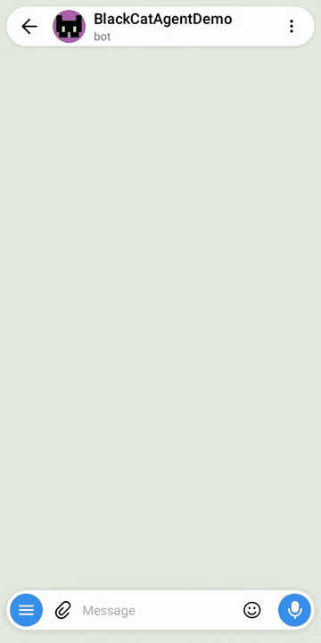
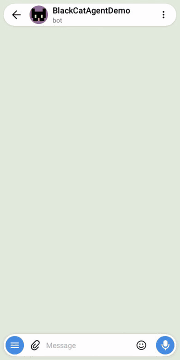

<p align="center">
  
</p>

# blackcat

blackcat is a personal agent that runs on a small always-on computer at home. It keeps a searchable copy of your messages, reminds you, watches for things you care about, and looks after your machines.

You use it from a terminal on the machine, and optionally from your phone through a **channel**: a chat that carries your messages to blackcat and its replies back. A Telegram bot is the channel that comes with it; others can be added as plugins.

It works at two levels:

- Without an AI model, it runs the commands, shortcuts, reminders and checks you set up.
- With one, you also talk to it in plain words. It reads your messages for you, and it sets things up when you ask: "remind me every Monday to put the bins out", "make a /door command that sends me a picture from the front door camera", "watch the school group for anything I need to act on".

```
you       what do I need to do this week?
blackcat  Three things. The school trip form is due Thursday. Maya asked on
          Monday whether you can drive on Saturday and you haven't answered.
          The car insurance renews on the 14th.

you       remind me about the form on Wednesday evening
blackcat  Done. Wednesday at 18:00.
```

<table>
  <tr><th>In a terminal</th><th>In Telegram</th></tr>
  <tr>
    <td></td>
    <td></td>
  </tr>
</table>

It was written for a Raspberry Pi and runs on any Linux machine.

## Contents

- [What it can do](#what-it-can-do)
- [Install](#install), on a machine or [in a container](#in-a-container)
- [Set up](#set-up)
- [Using it](#using-it)
- [Core features](#core-features): messages, reminders, watches, briefing, checks, shortcuts, messages from your scripts, memory, backups
- [Plugins](#plugins): WhatsApp, Telegram, mail, calendar, SSH, this machine, Home Assistant, UniFi, Allsky, Android, LG TVs, files in messages
- [Running it](#running-it)
- [Security](#security)
- [Files and settings](#files-and-settings), [for developers](#for-developers), [license](#license)

## What it can do

| | | Needs a model |
|---|---|---|
| Chat | Talk to it in plain words, in a terminal or a chat channel. It remembers what you tell it. | yes |
| Commands | Every feature is a `bc` command. In a chat channel the same commands work with a slash: `/backup now`. | no |
| Shortcuts | Commands you define: `/door` sends a picture from the front door camera. | no |
| Reminders | "Remind me on Friday to call the bank", or `/remind add …`. | only for plain words |
| Messages | WhatsApp, Telegram and mail in one local archive. Read-only. Search by keyword or by meaning. | no |
| Watches | "Watch the school group for anything a parent must act on." Each keeps a list. | yes |
| Daily briefing | One message each morning: today, tomorrow, the week, what is new. | only for what watches add |
| Checks | "Is the camera still taking pictures? If not, restart it and tell me." | only to judge by description |
| Machines | Other machines over SSH, this machine's health, Home Assistant, a UniFi network, an all-sky camera. | no |
| Apps on Android | Routines that go through an app on an Android phone or TV, and stop to ask you before anything is booked, bought or sent. | only to learn a routine, or when a step goes wrong |
| LG TVs | On and off, the volume, the input, an app, the remote's buttons, a message on the screen. | no |
| Approvals | The agent works only through blackcat's commands, and shows you anything that changes something first. | |
| Backups | A nightly copy to another machine or disk, optionally encrypted. | no |

## Install

You need Linux and Node.js 22 or later. With systemd, blackcat starts at boot by itself; without it (a container), you start it with one command. Recommended: [Claude Code](https://claude.com/claude-code), signed in, to talk to blackcat in plain words (it runs the model under your own login, so no API key is needed), and a Telegram account, to use it from your phone.

```sh
sudo apt install git zstd gnupg openssh-client ffmpeg unzip imagemagick poppler-utils tesseract-ocr antiword build-essential python3
git clone https://github.com/vpuna/blackcat.git ~/blackcat && cd ~/blackcat
npm install
mkdir -p ~/.local/bin && ln -sf "$PWD/bin/bc.js" ~/.local/bin/blackcat
echo 'alias bc=blackcat' >> ~/.bashrc && source ~/.bashrc
timedatectl set-timezone Europe/Lisbon     # reminders and schedules use local time
```

`bc` is only an alias, so scripts that use the calculator of the same name still work. If `blackcat` is not found, log out and in again so `~/.local/bin` is on your `PATH`. The folder you cloned into is the installation; settings and data go in `data/` inside it, created the first time you run a command.

### In a container

```sh
docker build -t blackcat .
docker run -d --name blackcat --restart unless-stopped -e TZ=Europe/Lisbon \
  -v blackcat-data:/blackcat/data -v blackcat-home:/home/blackcat blackcat

docker exec -it blackcat bc status          # every command works the same way
docker exec -it blackcat claude             # optional: sign in to Claude Code
```

- Keep `/blackcat/data` (settings, messages, logins) and `/home/blackcat` (the Claude Code sign-in) outside the container, so an update loses nothing.
- It runs as user 99:100, as Unraid expects (`--user` for another). `bc host` is the container: add the computer it runs on as an SSH host.
- `unraid/blackcat.xml` is a template for Unraid's Docker tab; `docker-compose.yml` is the same for Compose.
- To wake a TV, run it with `--network host`: the wake-up packet does not get past Docker's own network. Pair Android devices over the network (`bc android pair --address`).

## Set up

```sh
bc service install      # run in the background, now and at boot
bc status               # what is running
bc remind add Call the bank --in 2d
bc chat                 # where reminders and reports arrive until you add a channel; type /help
```

### A model (recommended)

```sh
claude                  # sign in to Claude Code once, then /exit
bc restart agent
bc chat what can you do
```

Everything in this guide can then be done by asking. Without a model, everything marked "no" above still works.

### The Telegram bot (recommended)

Create a bot with [@BotFather](https://t.me/BotFather) and copy its token.

```sh
bc tg bot pair          # paste the token, then scan the QR code with your phone
bc restart agent
```

The bot answers only the accounts you pair, in a private chat. Try `/ping` and `/help`. This is separate from linking your own Telegram account (below), which lets blackcat read your chats.

### Then connect what you want

Each is optional. All of them only read, except where the row says otherwise.

| To connect | Run | You need |
|---|---|---|
| WhatsApp messages | `bc wa pair` | your phone, to scan a QR code |
| Your Telegram account's messages | `bc tg account pair` | an api_id and api_hash from my.telegram.org |
| Email | `bc plugin enable mail`, then `bc mail add` | the address and an app password |
| Calendars | `bc plugin enable calendar`, then `bc calendar add` | the calendar's iCal address |
| Other machines, over SSH (can act, with your approval) | `bc plugin enable ssh`, then `bc ssh add` | the address and a user; you install the key it prints |
| This machine: health alerts and commands (can act, with your approval) | `bc plugin enable host`, then `bc host setup` | nothing |
| Home Assistant (can act; see its section) | `bc plugin enable ha`, then `bc ha setup` | the address and a long-lived access token |
| A UniFi network and cameras | `bc plugin enable unifi`, then `bc unifi setup` | the console's address and an API key |
| An all-sky camera | `bc plugin enable allsky`, then `bc allsky setup` | its address |
| An Android phone or TV (can act; see its section) | `bc plugin enable android`, then `bc android pair` | adb (`sudo apt install adb`), and debugging switched on in the device's Developer options |
| An LG webOS TV (can act; see its section) | `bc plugin enable webos`, then `bc webos pair` | its address; you allow it on the TV |
| Voice notes | `bc voice setup` | nothing; the speech model is downloaded once and runs on the CPU |
| Backups to another machine or disk | `bc backup setup` | an SSH host added above, or a folder |

After enabling a plugin, run `bc restart agent` so the agent knows about it. In a chat channel, `/setup` asks the same questions with buttons.

## Using it

In a terminal, `bc <command> --help` explains any command, and `bc chat` works like a chat channel, with the same slash commands, in a conversation of its own (`bc chat <question>` asks one and exits). [docs/commands.md](docs/commands.md) lists every command with all its options.

In a chat channel, write anything and the agent answers. These are handled directly, without the model:

| | |
|---|---|
| `/help` | what it can do |
| `/briefing` | today's briefing |
| `/watch`, `/remind`, `/check`, `/ha` | your watches, reminders, checks and rooms, with buttons |
| `/setup` | set a plugin up by answering questions |
| `/permissions` | standing approvals; remove any |
| `/status` | the machine's health |
| `/new`, `/resume` | start a fresh conversation, or go back to an earlier one |

Any `bc` command also works with a slash: `/backup now`, `/unifi status`, `/bc plugin list`; add `help` to see what one does (`/watch help`). You can also send photos, PDFs, documents and voice notes.

### Approvals

When the agent wants to do something that changes anything, it shows you the exact command and waits.

| | |
|---|---|
| Allow once | runs this time |
| Always allow | this exact command runs without asking from now on |
| Not now | refused; it will ask again next time |
| Never allow | this exact command is always refused |

A prompt expires after five minutes, and writing a message instead of tapping counts as Not now. `bc permissions` lists the standing answers and removes them.

<table>
  <tr><th>In a terminal</th><th>In Telegram</th></tr>
  <tr>
    <td></td>
    <td></td>
  </tr>
</table>

## Core features

These are part of blackcat itself. Reminders, watches, checks and backups can each be switched off with `bc plugin disable <name>`. Anything that repeats takes `--at`, `--days`, or cron (`minute hour day-of-month month day-of-week`, local time), and blackcat repeats each schedule back in words with its next times.

### Messages

One local archive of everything your sources collect. Nothing here sends. Search by meaning uses an index built on the machine.

```sh
bc msg find when did we decide on the holiday         # by meaning
bc msg search dinner saturday --chat Family --since 30d
bc msg thread Family --since 3d
```

<table>
  <tr><th>In a terminal</th><th>In Telegram</th></tr>
  <tr>
    <td></td>
    <td></td>
  </tr>
</table>

### Reminders

```sh
bc remind add Pay school fees --at "2026-10-05 09:00"
bc remind add Take the bins out --at 20:00 --repeat weekly
bc remind list
```

A reminder arrives with Done and snooze buttons. `bc remind setup --quiet 23:00-07:00` sets quiet hours.

<table>
  <tr><th>In a terminal</th><th>In Telegram</th></tr>
  <tr>
    <td></td>
    <td></td>
  </tr>
</table>

### Watches

A watch reads certain chats, collects what fits into a list, and tells you. Needs a model.

```sh
bc watch add School notices --chat "Year 4 parents" \
  --look-for "things a parent needs to act on: events, trips, deadlines, forms"
bc watch list
bc watch item 12 done                # or keep, drop
```

- A watch reports in the daily briefing (the default), on a schedule of its own (`--mode digest`) or at once (`--mode alert`).
- One is built in: "Things I need to do". It reads all your chats, and mail and calendar if connected, for promises, unanswered questions, deadlines, bookings and things on their way. It ticks off what you were waiting on when the answer comes, what you owed once you have plainly done it (the briefing says so, with a button to undo it), and a parcel or a booking when a message with its number says it arrived or was cancelled.

<table>
  <tr><th>In a terminal</th><th>In Telegram</th></tr>
  <tr>
    <td></td>
    <td></td>
  </tr>
</table>

### Daily briefing

One message each morning at 07:00: today, tomorrow, the week ahead, bookings and deliveries coming up, what is new on each watch, and what the model used yesterday. Tap a line's number to mark it done or snooze it. `bc watch briefing --at 06:30` moves it.

<table>
  <tr><th>In a terminal</th><th>In Telegram</th></tr>
  <tr>
    <td></td>
    <td></td>
  </tr>
</table>

### Checks

A check looks at something on a schedule, tells you when it stops working, and can try a fix first.

```sh
# Is the camera taking pictures? If not, restart it. After two tries, tell me.
bc check add Camera --run "blackcat allsky check" \
  --fix 'sudo systemctl restart allsky' --tries 2 --wait 2m --every 30m

bc check add "Sky picture" --file ~/camera/latest.jpg --max-age 10m   # a file that should keep changing
bc check list
```

A check passes when its command exits with 0; with `--look-for "…"` a model judges the output or a picture against your words. Creating a check approves its fix, which then runs without asking. One check is always there: blackcat health, which reads its own record every hour for things going wrong.

With `--limit "temp>75"` a figure the command prints decides instead, and each reading is kept for 30 days. `--context '<command>'` keeps what that prints when the check goes wrong, so you can later ask why. Plugins offer some checks ready-made:

```sh
bc check offered                                   # e.g. ssh:nas-heat, a host's temperature and load
bc check add --from ssh:nas-heat --limit "temp>75"
bc check history "nas heat" --since 7d             # the readings, and each time it was too hot, with what was running
```

<table>
  <tr><th>In a terminal</th><th>In Telegram</th></tr>
  <tr>
    <td></td>
    <td></td>
  </tr>
</table>

### Shortcuts

A shortcut runs commands you chose and sends back a file or what they printed. It runs as `/<name>`, with no model involved.

```sh
bc shortcut add door --description "Front door camera" \
    --run "blackcat unifi snapshot 'Front Door'" --send ~/blackcat/data/unifi-media/front-door.jpg
bc shortcut schedule door --at 19:00 --days sat,sun    # send it by itself
bc shortcut action music play --run 'blackcat ha play "Living room speaker" --media "Dinner playlist"'
```

A shortcut made only of actions is a menu: `/music` shows them as buttons. A step can wait for something before the next one runs, and stops the shortcut if it never comes. With three steps or more, they show in one message, ticked as they go, with where it stopped.

<table>
  <tr><th>In a terminal</th><th>In Telegram</th></tr>
  <tr>
    <td></td>
    <td></td>
  </tr>
</table>

### Messages from your own scripts

Any script or cron job on the machine can send you a message through the channel in use. Use `blackcat`, not `bc`, in scripts: the alias exists only in your shell.

```sh
./build.sh && blackcat notify --from build "Done" || blackcat notify --from build "FAILED"
df -h / | blackcat notify --from disk               # the text can be piped in
```

It arrives as `build: Done`, outside your conversation with the agent, and exits with 3 when there is no channel. The name is a label, not proof: anything running as you can use it; the agent cannot.

<table>
  <tr><th>In a terminal</th><th>In Telegram</th></tr>
  <tr>
    <td></td>
    <td></td>
  </tr>
</table>

### Memory and conversations

Tell the agent things worth keeping ("Sam is my brother") and it has them in every later conversation. Forgetting or replacing a memory needs your approval. `bc memory list` shows them; `bc conversations find "school trip"` searches what was said, kept for 90 days.

<table>
  <tr><th>In a terminal</th><th>In Telegram</th></tr>
  <tr>
    <td></td>
    <td></td>
  </tr>
</table>

### Backups

A nightly copy of everything that cannot be recreated, kept on another machine or disk. You are told only when one fails. A backup holds your messages and the logins for your accounts: encrypt it, and keep the passphrase somewhere else too.

```sh
bc backup setup --place ssh:nas --dir /srv/backups/blackcat --time 03:30 --keep 14 --encrypt
bc backup now
bc backup restore --file <file> --apply   # also to move to another machine; --paused starts nothing
```

What a restore replaces is kept in `data/before-restore-<date>`. Into a container, restore with it stopped:

```sh
docker stop blackcat
docker run --rm -it -v blackcat-data:/blackcat/data -v /path/to/backups:/backups:ro blackcat \
  blackcat backup restore --file /backups/<file> --apply
docker start blackcat
```

<table>
  <tr><th>In a terminal</th><th>In Telegram</th></tr>
  <tr>
    <td></td>
    <td></td>
  </tr>
</table>

## Plugins

`bc plugin list` shows what exists and what is on; `bc plugin enable <name>`, then `bc restart agent`. Disabling keeps a plugin's settings and data (`--data` deletes them).

| Plugin | What it does | On by default |
|---|---|---|
| `tg-bot` | a channel: the Telegram bot | yes |
| `claude-code` | runs the model through Claude Code | yes |
| `wa`, `tg` | collect WhatsApp, and your own Telegram account's messages | yes |
| `voice`, `ocr`, `docs` | read voice notes, text in pictures, and documents, on the machine | yes |
| `shortcut` | commands you define | yes |
| `mail`, `calendar` | collect email over IMAP; read your calendars | no |
| `ssh`, `host` | other machines; this machine | no |
| `ha`, `unifi`, `allsky` | Home Assistant; a UniFi network and its cameras; an all-sky camera | no |
| `android`, `webos` | apps on Android phones and TVs; LG webOS TVs | no |

"On by default" means switched on; each still needs its own `pair`, `setup` or `add` before it does anything.

### WhatsApp and Telegram

`bc wa pair` links blackcat as a companion device, like WhatsApp Web; it never sends. Only the chats you choose are collected (`bc wa select`: all of them, leaving out any you pick, or only the ones you pick), with history from your phone as far back as the days you choose. This uses WhatsApp's unofficial protocol, which is against its terms; reading only keeps the risk of a ban low, not zero.

`bc tg account pair` logs in to your own Telegram account as another device, through Telegram's official API; it never sends. `bc tg account select` collects all your chats, leaving out any you pick, or only the ones you pick. Your chat with blackcat's bot is never collected.

What is stored is kept, however old. When something is missing, `bc wa recover`, `bc tg account recover` or `bc mail recover` goes through the history again and keeps only what is not there yet.

### Mail and calendar

Mail is read-only over IMAP. Newsletters and promotions are skipped by rules, with no model (`bc mail recent` says what was kept or skipped, and why; `bc mail allow` and `bc mail block` change it). Mail you send is collected too, so a promise you made by mail reaches your watches.

Calendars are read-only; six months of past events are kept, and events appear in the daily briefing. The iCal address is in Google under Settings → the calendar → "Secret address in iCal format"; in iCloud, share as a public calendar; in Outlook, publish the calendar and copy the ICS link.

### SSH and this machine

```sh
bc ssh add                     # a name, address, user and mode; prints a key to install there
bc ssh run nas 'docker ps'
bc host health                 # temperature, load, memory, disk
bc host setup --alerts --temp-limit 75 --disk-limit 90
```

Each machine has a mode for what the agent may do there: `read` (commands that only look), `ask` (anything else needs your approval) or `full`. Each SSH host gets its own key. A health limit crossed sends you one message. `bc host run` is the only way the agent can run a command on this machine, and every SSH host is also a place a backup can go.

<table>
  <tr><th>In a terminal</th><th>In Telegram</th></tr>
  <tr>
    <td></td>
    <td></td>
  </tr>
  <tr>
    <td></td>
    <td></td>
  </tr>
</table>

### Home Assistant, UniFi and Allsky

```sh
bc ha on living room lamp                # also: off, toggle, open, close, lock, unlock
bc ha play bedroom speaker --media "rain" --volume 30
bc unifi clients --match iphone
bc unifi snapshot "Living Room"
bc allsky startrails --night yesterday   # also: now, keogram, timelapse
```

In Home Assistant, lights, switches and media players act freely; climate and blinds ask first; locks, alarms and gates ask every time (`bc ha level` changes that). `/ha` opens a browser of rooms with buttons. Allsky is the [Allsky](https://github.com/AllskyTeam/allsky) camera software, on this machine or another.

<table>
  <tr><th>In a terminal</th><th>In Telegram</th></tr>
  <tr>
    <td></td>
    <td></td>
  </tr>
  <tr>
    <td></td>
    <td></td>
  </tr>
</table>

### Android

For apps on an Android phone, tablet or TV, on USB or the network. Give it a device of its own: it has to stay signed in to the apps and cannot have a PIN or pattern lock. Most apps do not allow being driven like this, so you use it at your own risk.

A **routine** goes through an app the way you would and stops at the button that books, buys, pays or sends: it shows you the screen, and only your ✅ presses it. It takes values, so one routine does every order.

```sh
bc android pair --name phone             # or --address 192.168.1.50:5555 for a TV
bc android learn shop-buy --app shop --goal "Search for the item, add the first result to the basket and go to checkout. Stop at Place order." --stop-at "Place order" --set item="AA batteries"
bc android run shop-buy --dry --set item="AA batteries"   # to the button, then declines
bc android approve shop-buy                               # lets the agent run it
bc android edit shop-buy --change "choose next-day delivery before checkout"
```

In the bot, ask for a change in words, with pictures of the app if you have them.

`learn` has a model work out the steps on the device, for about 20 to 30 US cents. A run after that uses no model, unless a step goes wrong. A routine need not end at a confirmation: one for a TV box can press a channel's number and send you the screen. How routines work, their file format and their limits are in [docs/architecture.md](docs/architecture.md#android-devices).

<table>
  <tr><th>In Telegram (<a href="docs/images/demo-ride.mp4">video</a>)</th></tr>
  <tr><td></td></tr>
</table>

### LG TVs

```sh
bc webos pair --name tv --address 192.168.1.40   # the TV asks you to allow it
bc webos on                                       # and off
bc webos input "hdmi 2"
bc webos launch netflix
bc webos volume up 5
```

To be turned on, the TV must listen for it while it is off: Settings → General → Devices → "Turn on via Wi-Fi" (or "Mobile TV On"). The agent may look freely; anything that changes the TV asks you first. A shortcut can use both plugins: turn the TV on, switch it to the TV box and start a channel there with an Android routine; a menu of channels changes it after.

<table>
  <tr><th>In Telegram (<a href="docs/images/demo-tv.mp4">video</a>)</th></tr>
  <tr><td></td></tr>
</table>

### Files in messages

Voice notes, pictures and documents in the chats you collect are read when they arrive, and their words are kept with the message, for searches and watches. Only the words stay, not the file. For each kind you choose who reads it (`bc msg reading`, or `/setup`):

| | |
|---|---|
| `local` | this machine only; nothing leaves it |
| `model` | the model, for every file |
| `both` (the default) | this machine first, and the model only when its reading is not sure enough |
| `off` | not read |

Voice notes are always transcribed on the machine. Spreadsheets and presentations are not read.

<p align="center">
  
</p>

## Running it

```sh
bc status                     # what blackcat last saw
bc selftest                   # ask everything that is set up whether it works now
bc logs agent -f
cd ~/blackcat && git pull && npm ci && bc restart     # update
bc service run                # run in this terminal until Ctrl+C, instead of installing it
```

### The model

```sh
bc engine setup --for chat --model opus --effort high
bc engine setup --for readers --model haiku     # the background reading of messages
bc engine check                                 # test the model's safety and accuracy; you accept or decline
```

The check runs in a temporary copy of your installation with made-up messages, asks the model to do things that are not allowed, and confirms that nothing happened.

### Activity

blackcat keeps a 30-day record of what it did and what you did directly: calls to the model with their cost, commands, scheduled work, what it sent you. It never holds what was said.

```sh
bc activity recent --failed
bc activity slow                      # the slowest work, and where its time went
bc activity usage --since 30d --by model
```

## Security

Only you can instruct blackcat: from a terminal on the machine, or from the channel you paired with your own account. blackcat also reads what other people wrote, and any of it could contain text meant to trick an AI. It treats it as information, never as instructions, and does not rely on the model alone for that:

- The agent can only run blackcat's own commands. Looking runs freely; anything that changes something waits for your answer.
- It opens files only in blackcat's folders of things you sent and fetched, and cannot write files. Your passwords, tokens, keys and settings are always refused.
- It has no web access, and your message sources are read-only: it cannot send a WhatsApp message, a Telegram message from your account, or an email. Replies go only to you.
- Reading in bulk is done by a separate model with no tools, which can only return text.
- On an Android device, only a routine's confirmation step presses a button that books, pays or sends, after your ✅.

Enter tokens and passwords in a terminal or through `/setup`, never in an ordinary chat message. There is no sandbox: blackcat runs as your user, and a plugin is code that runs with your access, so read one that someone else wrote before you enable it. The full account, with its limits, is in [docs/architecture.md](docs/architecture.md#security-model).

## Files and settings

Everything is in the folder you installed to. `data/` holds the settings (`config.json`, no secrets), the databases and each plugin's secrets, readable by your account only and left out of git. `agent/AGENT.md` is the agent's persona and rules, and `user-plugins/` holds plugins of your own. [docs/architecture.md](docs/architecture.md#data) describes each file.

## For developers

| | |
|---|---|
| [docs/architecture.md](docs/architecture.md) | how it is built, the security model, the engine check, tests |
| [docs/commands.md](docs/commands.md) | every command and option (generated) |
| [docs/plugins.md](docs/plugins.md) | writing a plugin, including a channel or an engine |

`bc plugin new weather` starts a plugin from a working template.

## License

Copyright © 2026 vpuna. Licensed under the [Elastic License 2.0](LICENSE). You may use, copy, modify and redistribute blackcat, including inside your own product. You may not offer it to others as a hosted or managed service.

The WhatsApp and Telegram-account plugins depend on libraries under the GPL-3.0; see [third-party terms](docs/architecture.md#third-party-terms).

You use blackcat at your own risk. It comes as it is, with no warranty, and its author is not responsible for lost data, missed messages or reminders, an account restricted or banned, or anything done on your approval. It is not made by or connected with WhatsApp, Meta, Telegram, Anthropic or any other service it connects to. Keep backups of your own.

## Status

This is one person's project, used daily. Expect rough edges.

Found a problem, or want something it does not do? Open an issue at [github.com/vpuna/blackcat](https://github.com/vpuna/blackcat/issues). For a security problem, say only that you have one, and you will be asked how to send the details.
